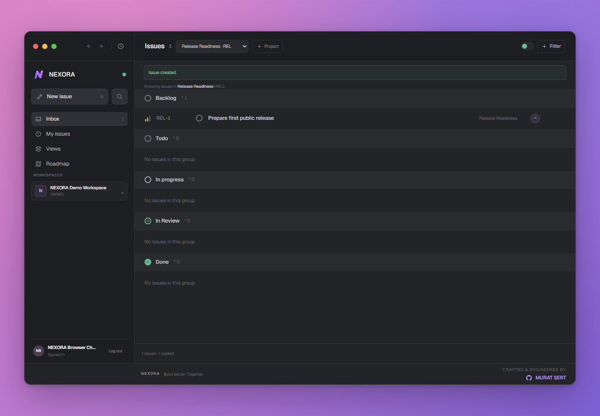

# NEXORA

**A self-hosted workspace for projects, priorities, and team delivery.**

NEXORA brings organizations, projects, and issue tracking together in one
workspace. It is built as a TypeScript monorepo and can be deployed on your own
infrastructure with Docker Compose, PostgreSQL, and Caddy.



The screenshot shows the real NEXORA web application running in an isolated
local production deployment. The workspace and issue are disposable test data.

## What it does

- Organizes work in organizations, projects, and sequentially numbered issues.
- Supports issue status, priority, descriptions, due dates, and organization
  members as assignees.
- Provides organization roles (`OWNER`, `ADMIN`, and `MEMBER`) with
  server-enforced permissions.
- Supports email verification and email invitations, including an operator-
  controlled public or invite-only registration policy.
- Uses database-backed sessions in HttpOnly cookies and validates request
  origins for state-changing API requests.
- Runs the API, web application, PostgreSQL, and reverse proxy as separate
  Docker Compose services.
- Supports SMTP for production and an optional Mailpit overlay for local
  email-flow testing.

## Architecture

```text
Browser
  │ same-origin HTTP/HTTPS
  ▼
Caddy ── /api/* ──► NestJS API ──► PostgreSQL 17
  │                   │
  └── other paths ─► Next.js    └── SMTP server
```

| Area | Technology |
| --- | --- |
| Web | Next.js 16, React 19, TypeScript |
| API | NestJS, Node.js ESM, TypeScript |
| Data | PostgreSQL 17, Prisma 7 |
| Monorepo | pnpm workspaces, Turborepo |
| Deployment | Docker Compose, Caddy |
| Tests | Vitest, Node.js regression tests |

## Quick start: isolated local deployment

### Requirements

- Docker Engine and Docker Compose v2.
- A checkout of this repository.
- Host ports `8080`, `8443`, `1026`, and `8026` available.

From the repository root, copy the local example and set a new local-only
PostgreSQL password. The password in `DATABASE_URL` must be the URL-encoded
form of the same password. Keep the real environment file private.

```sh
cp deploy/runtime.local.env.example deploy/runtime.env
```

For PowerShell:

```powershell
Copy-Item deploy/runtime.local.env.example deploy/runtime.env
```

Edit `deploy/runtime.env`, replacing the database password and its encoded
value in `DATABASE_URL`. Start the isolated app and Mailpit:

```sh
docker compose --env-file deploy/runtime.env -p nexora-local-test \
  -f compose.prod.yaml -f compose.local-test.yaml up -d --build
```

- App: <http://localhost:8080>
- Mailpit inbox: <http://localhost:8026>

The local example explicitly enables public registration and binds published
services to loopback. Use disposable accounts and data. This Compose project
uses its own PostgreSQL volume; it does not connect to a separate development
database. To stop the services while preserving data, use `docker compose
... down` **without** `-v`.

## Self-hosting

For a public deployment, use a DNS name, HTTPS, a reachable SMTP service,
unique production credentials, and a protected `deploy/runtime.env`. The
production Compose file keeps PostgreSQL and the API off published host ports;
Caddy is the ingress point and obtains certificates for the configured domain.
Production registration defaults to invite-only.

See [DEPLOYMENT.md](DEPLOYMENT.md) for the complete configuration reference,
production setup, initial owner bootstrap, migrations, backups, SMTP, and
troubleshooting. Do not expose the local-test overlay or Mailpit publicly.

For a new empty production database, run the documented interactive
`bootstrap:admin` CLI through the API container. It creates the first verified
owner and workspace atomically, refuses non-interactive input, and is
unavailable after the database contains users.

## Development

Requirements: Node.js 24 or later and pnpm 11.25.0. Start with:

```sh
corepack enable
pnpm install --frozen-lockfile
pnpm dev
```

The root development task starts workspace applications according to the
Turborepo configuration. The self-hosted local Compose workflow is documented
above; consult the individual app READMEs for package-specific commands.

## Validation

Run checks from the repository root:

```sh
pnpm install --frozen-lockfile
pnpm --filter api lint
pnpm --filter api build
pnpm --filter api test
pnpm --filter api exec prisma validate --config prisma7.config.ts
pnpm --filter web lint
pnpm --filter web check-types
node --test apps/web/lib/*.spec.mjs
pnpm --filter web build
pnpm --filter docs lint
pnpm --filter docs check-types
pnpm --filter docs build
pnpm audit --prod
```

Docker Compose validation and image build commands are in
[`.github/workflows/ci.yml`](.github/workflows/ci.yml) and
[DEPLOYMENT.md](DEPLOYMENT.md).

## Continuous integration

GitHub Actions runs on pushes to `main` and pull requests. The workflow checks
the API, web app, documentation app, Prisma schema, production dependency
audit, Compose configurations, and Docker images. Actions are pinned to
immutable commit SHAs and workflow permissions are read-only.

The workflow has been added to the repository but has **not yet run on
GitHub**. Its first hosted run should be reviewed before publication.

## Contributing and security

- Read [CONTRIBUTING.md](CONTRIBUTING.md) before opening a change.
- Follow [SECURITY.md](SECURITY.md) to report a vulnerability privately.
- Never include credentials, session cookies, invitation links, or real user
  data in issues, logs, or screenshots.

## Project status

NEXORA is under active development. Self-hosting and the documented features
are available, but this repository has not completed its first public release
gates. Review the security policy and current release notes before operating
an internet-facing instance.

**License:** No license has been selected yet. Do not assume permission to
reuse, distribute, or modify this project until a license is added.
